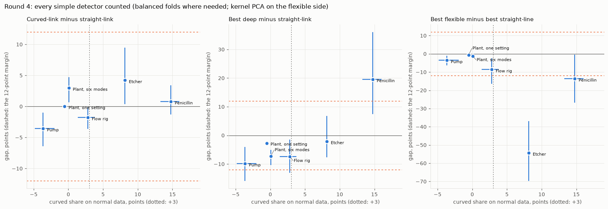

# Deep Learning in Anomaly Detection

Plants and machines carry dozens of sensors that move together, and a fault often shows up as sensors that stop moving together the way they normally do. This project asks when a flexible model of those links, such as a neural network, catches more faults than a straight-line model. It measures how curved the links are on normal data alone, then checks whether that measure says in advance where flexible and deep models will do better.

## What has been found so far

**The headline, as far as the evidence goes** (round 4, notebooks 09, 10 and 14)

- **No deep model beat the best simple detector on any dataset**: not on the six real and simulated datasets, and not on any of the 11 faults of a generated campaign of 320 penicillin batches. Against every simple detector, the best deep model ties on three datasets and is **behind** by the 12-point margin on the flow rig and the penicillin batches. On the metal etcher it is behind too, though round 4's large gap there was an artefact (next point); without the edited columns it is behind the CUSUM chart or ties it.
- **The one apparent deep win was the recipe schedule.** On the penicillin batches the autoencoder's gain came from knowing which values the recipe's stepped controller outputs take. A lookup of normal readings does the same job better: the nearest normal reading on all sensors catches 0.78 of faulty readings against the autoencoder's 0.64.
- **The metal etcher's memory-check "win" was an artefact of how its data were edited** (round 5, notebook 09, section 16). Round 4 found that an *unseen value check* on every sensor caught 0.95 of the etcher's faulty readings. But each etcher fault changed one setting, and the data's authors then edited that setting's column back so the fault would show only through the other sensors; on 17 of the 21 faulty wafers the unseen values sit in that edited column and nowhere else. Without the edited columns the check catches 0.16 to 0.17 and trails every other top detector; what it still catches (the pressure faults, through the valve that holds the pressure) is real.
- **Memory checks lead on the penicillin batches**, where faults put a stepped controller output at a value or combination the recipe never takes (the nearest normal reading on all sensors, 0.78). Elsewhere they trail detectors that model the links. A second measure on normal data, the *repeat share* (how often a new normal reading lands within noise of another run's), does not say in advance where they win (notebook 10, section 6).
- **A positive control found no deep win either.** Artificial data built so that a deep model should win (smoothly varying hidden drivers, sensors bent by squares, products and sines, faults that break one bent link) gave no setting out of 24 where a deep model beat the best simple detector. Our autoencoder needed 10,000 normal readings to match PCA on a flat surface, and 50,000 to learn a bent one, where a link detector matched it. **That is a limit of this project's deep setup** (notebook 09's design: bottleneck from PCA's component count, at most 100 training passes), and of the generator: with 40 sensors its bends were flat for a straight line through the other sensors (notebook 14).
- **"Recent history wins" was mostly a fold artefact.** On the six-mode plant a straight forecaster looked best. Its lead came from how the link detectors' error scales were set: the held-out blocks left whole operating modes unseen. With balanced folds every link detector gains 19 to 38 points, and the kinked-link detector (0.71) and the straight forecaster (0.69) tie (notebook 09, section 13).

**How curved the links are**

- **The curve can be measured on normal data.** Each sensor is predicted from the others, first by a straight line and then by a flexible model, on data the models never saw. The *curved share* is how much more the flexible model explains, in points. On a water pump and a simulated chemical plant it is zero or below. On a real flow rig it is about +3 points; on the chemical plant run in six modes, +0.07.
- **Two batch processes clearly bend:** a plasma etcher (+8 points) and a penicillin fermentation (+15). The bends are mostly corners, ceilings, switches and steps of the control system, not smooth curves. **A straight model allowed a few corners recovers half to two thirds of the curve.**

**What catches faults**

- **A curved model of the links does not catch more faults than a straight one** on any of the six datasets. The two tie everywhere, within about 4 points.
- **How a detector's error scale is set can flatter or wreck it.** On the six-mode plant, telling the straight-link detector the operating mode looked like it made it worse (0.30 against 0.46 of faulty readings caught): the blocks of data held out to set its error scale each contained most of one mode. A fold audit of every dataset (round 4) found the same problem on the flow rig (two flow settings left unseen) and nowhere else; with balanced folds the six-mode link detectors gain 19 to 38 points, and on the flow rig numbers move by up to 7.
- **The alarm lines carry over.** On the faulty runs' own readings before each fault, only 1 of about 120 detector-and-dataset pairs raises more than 3% false alarms (the isolation forest on the penicillin batches, 4.7%). The CUSUM chart's 36% on the penicillin batches, reported earlier, counted readings after the fault too; before the fault it is under 1.3%.
- **How errors are turned into a score mattered as much as the model.** The autoencoder led PCA by 13 to 30 points on five of the six datasets. Against PCA scored exactly like it, it leads on only two (the water pump and the penicillin batches); on the other three, the lead was the scoring.
- **A straight forecaster that uses each sensor's recent readings looked like the best detector on the six-mode plant** (0.69 of faulty readings, against 0.59 for an LSTM). That lesson was mostly the fold artefact above: with balanced folds the link detectors catch 0.67 to 0.71 (notebook 09, section 13).
- **On faults where one sensor moves on its own, no deep model beats a per-sensor check** (rolling z-score, EWMA or CUSUM) on the water pump or the chemical plant.

**The one deep-model win, and fair simple rivals** (rounds 2 and 3)

- **On the published penicillin batches the autoencoder beat every simple detector we had** (0.64 of faulty readings caught against 0.45, +19 points), all of it from three batches with the same fault: the sugar feed held at the wrong rate. **Then three simple checks that know the schedule were added, and one of them ties it.** The *unseen value check* (was each stepped controller output's value ever seen in normal batches?) catches 0.645 against the autoencoder's 0.639, with no false alarms on the faulty batches' normal readings; the *nearest normal reading* catches 0.59. By a rule fixed before computing, **the autoencoder's edge there is knowing the schedule, not depth. No deep model now beats the best simple detector on any dataset** (notebook 09, section 12). *Round 4:* the nearest normal reading on all sensors catches 0.78, so the autoencoder is now 14 points behind (notebook 09, section 14).
- **What it learned** (notebook 11): in a recipe batch, six controller outputs (the feeds, the air flow, the pressure) step through a fixed schedule, so together they take only a few dozen combinations, islands that no straight line passes through. The fault puts the sugar feed off those islands, at a value that is normal on its own. That beats straight-line models, but a lookup of normal values sees it too.
- **A generated campaign of 320 batches** (notebook 13) says the same with more evidence. With 30 batches of the published fault, the autoencoder beats the best of the earlier simple detectors by 17 points, but the unseen value check and the nearest normal reading catch every faulty reading. Held instead at values the recipe does use, the unseen value check misses by design, but the nearest normal reading still catches everything (the autoencoder, 0.90). With operator-run batches in the normal data, the autoencoder falls to 0.72 to 0.78 while the schedule checks still catch most of the fault. No deep model beats the best simple detector on any generated fault.
- **The generator** (notebook 12) agrees: at no dial setting and no fault size does the autoencoder lead the best simple detector by 12 points; the nearest normal reading catches every fault.
- **GDN and USAD failed a basic self-check in our implementation** (catching a simulated broken link), and versions moved step by step to the authors' own code failed it too. They were not run on the real data.

**Across the six datasets**, more curve on normal data goes with more gain from flexible models *over the straight-link detector*: in 11 or 12 of the 15 pairs of datasets, the one with more curve also has the bigger gain. *Against every simple detector* (round 4) it goes the other way: the two most curved datasets (the etcher and the penicillin batches) are where a memory check beats every flexible model, and the curve and the gain are in the same order in only 3 of 15 pairs (notebook 10, section 5). Six datasets make a picture, not a test.

**More data, and artificial data**

- **More penicillin batches can be generated, and were:** PenSimPy, an open-source Python port of the simulator, runs here after four small fixes (the fourth gives its operator-run batches their random steps), about 11 seconds per batch. A campaign of 320 batches (every seed recorded) takes about 20 minutes on 8 processes. To rebuild it: `bash anomaly_lab/tools/make_pensim_env.sh`, then `python -m adlab.pensim campaign 8` in that environment (`anomaly_lab/results/indpensim_generation_feasibility.md`).
- **A generator of artificial batches** (`adlab/simulate.py`) has one dial that turns the islands of the controller outputs from absent (straight ramps) to penicillin-like strength and beyond. At dial 0 the curve on normal data is zero; at dial 2 it is +12.5 points, near the penicillin batches' +15, and a few corners recover two thirds of it, as on the real batches (notebook 12).
- **A pilot on it:** against straight-line detectors, the autoencoder's gain grows with the dial (+39 points at dial 1, +45 at dial 2). Counting the schedule-aware checks, it has no gain at any dial setting or fault size (notebook 12). The generator was built from the penicillin batches, so it shows what the ingredient does, not what happens on other plants.



## Start here

1. `project_overview.pdf`: what the project is about and how it is set up.
2. Then the notebooks in `anomaly_lab/`, in order:

| Notebook | In one line |
| --- | --- |
| `main.ipynb` | The first pilot: eight simple detectors on a water pump (SKAB) and a simulated chemical plant (Tennessee Eastman) |
| `02_how_curved.ipynb` | How curved the links between sensors are on those two, and what kind of fault each fault is |
| `03_fresh_runs.ipynb` | The same detectors on 1,000 fresh runs of the chemical plant they had never seen |
| `04_delayed_links.ipynb` | Whether links that arrive late change the picture |
| `05_cranfield.ipynb` | A real flow rig run at 20 flow settings |
| `06_multimode_tep.ipynb` | The chemical plant run in six operating modes, and detectors on its faults |
| `07_metal_etch.ipynb` | A plasma etcher, wafer by wafer: the first dataset whose links clearly bend |
| `08_indpensim.ipynb` | A penicillin fermentation, batch by batch |
| `09_deep_models.ipynb` | Four deep models, each beside a simple twin, on all six datasets |
| `10_across_datasets.ipynb` | All six datasets side by side: does the curve on normal data predict where flexible models win? |
| `11_indpensim_deep_dive.ipynb` | Why the autoencoder wins on the penicillin batches, and which ingredient does it |
| `12_mechanism_generator.ipynb` | Artificial batches with that ingredient on a dial, and a pilot across dial settings and fault sizes |
| `13_pensim_campaign.ipynb` | A generated campaign of 320 penicillin batches: the deep win put to a proper test |
| `14_positive_control.ipynb` | Artificial data built so that a deep model should win: did it? |

Two reports sit beside the notebooks: `anomaly_lab/results/decision_point.md` (the decision of 16 November to change the project's direction, and where the hypotheses stand now) and `anomaly_lab/results/indpensim_generation_feasibility.md` (whether more penicillin batches can be generated).

## The datasets

None of the data is stored in this repository. Each set goes into its own folder under `anomaly_lab/data/raw/`.

| Dataset | What it is | Source | Licence (as stated at the source) | How to get it | Folder under `anomaly_lab/data/raw/` |
| --- | --- | --- | --- | --- | --- |
| SKAB | A water pump test rig with 8 sensors; 34 recordings with valve and pump faults (Skoltech) | [github.com/waico/SKAB](https://github.com/waico/SKAB) | GPL-3.0 | `python -m adlab.download skab` | `skab/` |
| Tennessee Eastman, Braatz files | A simulated chemical plant with 52 sensors; one normal run and 21 kinds of fault | [github.com/camaramm/tennessee-eastman-profBraatz](https://github.com/camaramm/tennessee-eastman-profBraatz) | University of Illinois licence (copyright 1998–2002, Braatz lab): free to use if the notice is kept | `python -m adlab.download tep` | `tep/` |
| Tennessee Eastman, Rieth files | The same plant, run 500 times per case with fresh random numbers | [doi:10.7910/DVN/6C3JR1](https://doi.org/10.7910/DVN/6C3JR1) (Harvard Dataverse) | Public domain dedication | `python -m adlab.download tep_rieth` (about 910 MB) | `tep_rieth/` |
| Tennessee Eastman, six modes | The same plant run in six operating modes, with mode changes and faults (Reinartz, Kulahci and Ravn 2021) | [doi:10.11583/DTU.13385936](https://doi.org/10.11583/DTU.13385936) (data.dtu.dk) | CC0 | `python -m adlab.download tep_multimode` (reads about 0.7 GB out of 143 GB) | `tep_multimode/` |
| Cranfield flow rig | A real three-phase flow rig with 23 sensors at 20 flow settings; 3 normal and 16 faulty runs (Ruiz-Carcel et al. 2015) | The `cvatutor` package, version 1.1.0, [MATLAB File Exchange 50938](https://www.mathworks.com/matlabcentral/fileexchange/50938) | Could not be checked: the page refuses automated access. Data not redistributed here | By hand: see `python -m adlab.download cranfield` | `cranfield/cvatutor-1.1.0/CVACaseStudy/` |
| Metal etch | A LAM 9600 plasma etcher: 19 machine readings, 108 normal and 21 faulty wafers (Wise et al. 1999) | [Eigenvector Research](https://eigenvector.com/resources/data-sets/metal-etch-data-for-fault-detection-evaluation/), file `MACHINE_Data.mat` | Not stated; data not redistributed here | `python -m adlab.download metal_etch` (about 2 MB) | `metal_etch/` |
| IndPenSim | A simulated 100,000-litre penicillin fermentation: 100 batches, 10 with faults (Goldrick et al. 2019) | [doi:10.17632/pdnjz7zz5x](https://doi.org/10.17632/pdnjz7zz5x) (Mendeley Data, version 2) | CC BY 4.0 | `python -m adlab.download indpensim` (about 0.5 GB) | `indpensim/` |

## How to run it

The project uses [uv](https://docs.astral.sh/uv/) and Python 3.12.

```bash
uv sync                              # the core install
uv sync --extra deep                 # or: with PyTorch for an NVIDIA GPU, for the deep models
uv sync --extra deep-cpu             # or: with PyTorch without the GPU parts
cd anomaly_lab
uv run python -m adlab.download all  # fetch every dataset that can be fetched without a login
uv run pytest                        # the tests; those that need a dataset you have not fetched are skipped
```

Then open the notebooks with Jupyter (`uv run jupyter notebook`). Each notebook saves its slow results in `anomaly_lab/results/cache/`, so a second run is quick. `anomaly_lab/README.md` describes the code folder by folder.

## About the code

The code is under the MIT licence (`LICENSE`); each dataset keeps its own licence, listed above.
