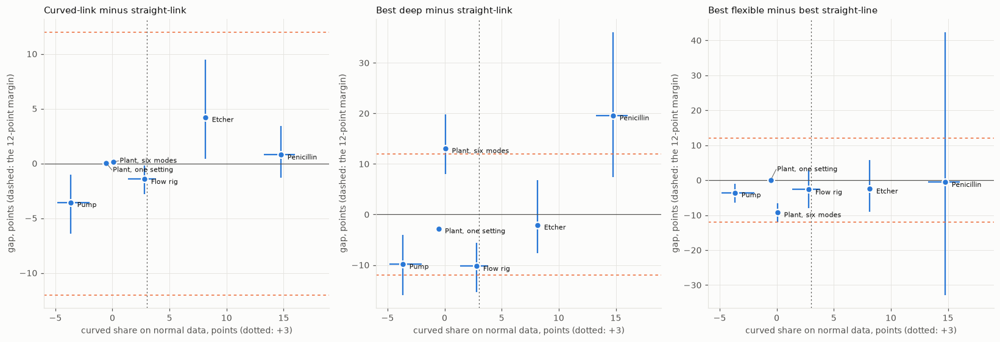

# Deep Learning in Anomaly Detection

Plants and machines carry dozens of sensors that move together, and a fault often shows up as sensors that stop moving together the way they normally do. This project asks when a flexible model of those links, such as a neural network, catches more faults than a straight-line model. It measures how curved the links are on normal data alone, then checks whether that measure says in advance where flexible and deep models will do better.

## What has been found so far

**How curved the links are**

- **The curve can be measured on normal data.** Each sensor is predicted from the others, first by a straight line and then by a flexible model, on data the models never saw. The *curved share* is how much more the flexible model explains, in points. On a water pump and a simulated chemical plant it is zero or below. On a real flow rig it is about +3 points; on the chemical plant run in six modes, +0.07.
- **Two batch processes clearly bend:** a plasma etcher (+8 points) and a penicillin fermentation (+15). The bends are mostly corners, ceilings, switches and steps of the control system, not smooth curves. **A straight model allowed a few corners recovers half to two thirds of the curve.**

**What catches faults**

- **A curved model of the links does not catch more faults than a straight one** on any of the six datasets. The two tie everywhere, within about 4 points.
- **Where the alarm line is set can flatter or wreck a detector, and we found both.** On the six-mode plant, telling the straight-link detector the operating mode looked like it made it worse (0.30 against 0.46 of faulty readings caught). The cause was how its error scale is set: the blocks of data it held out each contained most of one mode. On the penicillin batches, the CUSUM chart catches part of two faulty batches only because its line does not carry over: on the faulty batches' own normal readings it raises false alarms 36% of the time, not the 1% the line is set for.
- **How errors are turned into a score mattered as much as the model.** The autoencoder led PCA by 13 to 30 points on five of the six datasets. Against PCA scored exactly like it, it leads on only two (the water pump and the penicillin batches); on the other three, the lead was the scoring.
- **A straight forecaster that uses each sensor's recent readings was the best detector on the six-mode plant** (0.69 of faulty readings, against 0.46 for the link detectors and 0.59 for an LSTM).
- **On faults where one sensor moves on its own, no deep model beats a per-sensor check** (rolling z-score, EWMA or CUSUM) on the water pump or the chemical plant.

**The one deep-model win**

- **The autoencoder beats every simple detector on the penicillin batches:** 0.64 of faulty readings caught against 0.45, +19 points (range +6 to +36). It also beats PCA scored like it (+35), the kinked-link detector (+24), and holds with an alarm line set on the recipe batches alone (+22).
- **But it is narrow.** It rests on 10 faulty batches, and three of them carry all of it, all with the same fault: the sugar feed held at the wrong rate. Without the best of those three, or with one of the three training seeds alone, it becomes a tie.
- **What it learned** (notebook 11): in a recipe batch, six controller outputs (the feeds, the air flow, the pressure) step through a fixed schedule, and together they only take a few dozen combinations: islands that no straight line passes through. The fault puts the sugar feed between those islands, at a value that is normal on its own. The autoencoder trained on the controller outputs alone catches more of it than the full one (0.61 against 0.38 on those three batches); trained on the measurements alone, almost none (0.01). Scored exactly like the autoencoder, the curved-link detector still catches almost none of it (0.06): the scoring is not what makes the difference.
- **GDN and USAD failed a basic self-check in our implementation** (catching a simulated broken link), and versions moved step by step to the authors' own code failed it too. They were not run on the real data.

**Across the six datasets**, more curve on normal data goes roughly with more gain from flexible models: in 11 or 12 of the 15 pairs of datasets, the one with more curve also has the bigger gain. Six datasets make a picture, not a test.

**More data, and artificial data**

- **More penicillin batches can be generated:** PenSimPy, an open-source Python port of the simulator, runs here after three small fixes, about 11 seconds per batch, with the same faults as the published set (`anomaly_lab/results/indpensim_generation_feasibility.md`).
- **A generator of artificial batches** (`adlab/simulate.py`) has one dial that turns the islands of the controller outputs from absent (straight ramps) to penicillin-like strength and beyond. At dial 0 the curve on normal data is zero; at dial 2 it is +12.5 points, near the penicillin batches' +15, and a few corners recover two thirds of it, as on the real batches (notebook 12).
- **A first pilot on it:** the autoencoder's gain over the best simple detector grows with the dial, from none at dial 0 (where every detector catches every fault) to +39 points at dial 1 and +45 at dial 2. The generator was built from the penicillin batches, so this shows the ingredient is enough to give such a gain, not that it is what happens on other plants.



## Start here

1. `project_overview.pdf`: what the project is about and how it is set up.
2. Then the notebooks in `anomaly_lab/`, in order:

| Notebook | In one line |
| --- | --- |
| `main.ipynb` | The first pilot: eight simple detectors on a water pump (SKAB) and a simulated chemical plant (Tennessee Eastman) |
| `02_how_curved.ipynb` | How curved the links between sensors are on those two, and what kind of fault each fault is |
| `03_fresh_runs.ipynb` | The same detectors on 1,000 fresh runs of the chemical plant they had never seen |
| `04_delayed_links.ipynb` | Whether links that arrive late change the picture |
| `05_cranfield.ipynb` | A real flow rig run at 20 flow settings |
| `06_multimode_tep.ipynb` | The chemical plant run in six operating modes, and detectors on its faults |
| `07_metal_etch.ipynb` | A plasma etcher, wafer by wafer: the first dataset whose links clearly bend |
| `08_indpensim.ipynb` | A penicillin fermentation, batch by batch |
| `09_deep_models.ipynb` | Four deep models, each beside a simple twin, on all six datasets |
| `10_across_datasets.ipynb` | All six datasets side by side: does the curve on normal data predict where flexible models win? |
| `11_indpensim_deep_dive.ipynb` | Why the autoencoder wins on the penicillin batches, and which ingredient does it |
| `12_mechanism_generator.ipynb` | Artificial batches with that ingredient on a dial, and a first pilot |

Two reports sit beside the notebooks: `anomaly_lab/results/decision_point.md` (the decision of 16 November to change the project's direction) and `anomaly_lab/results/indpensim_generation_feasibility.md` (whether more penicillin batches can be generated).

## The datasets

None of the data is stored in this repository. Each set goes into its own folder under `anomaly_lab/data/raw/`.

| Dataset | What it is | Source | Licence (as stated at the source) | How to get it | Folder under `anomaly_lab/data/raw/` |
| --- | --- | --- | --- | --- | --- |
| SKAB | A water pump test rig with 8 sensors; 34 recordings with valve and pump faults (Skoltech) | [github.com/waico/SKAB](https://github.com/waico/SKAB) | GPL-3.0 | `python -m adlab.download skab` | `skab/` |
| Tennessee Eastman, Braatz files | A simulated chemical plant with 52 sensors; one normal run and 21 kinds of fault | [github.com/camaramm/tennessee-eastman-profBraatz](https://github.com/camaramm/tennessee-eastman-profBraatz) | University of Illinois licence (copyright 1998–2002, Braatz lab): free to use if the notice is kept | `python -m adlab.download tep` | `tep/` |
| Tennessee Eastman, Rieth files | The same plant, run 500 times per case with fresh random numbers | [doi:10.7910/DVN/6C3JR1](https://doi.org/10.7910/DVN/6C3JR1) (Harvard Dataverse) | Public domain dedication | `python -m adlab.download tep_rieth` (about 910 MB) | `tep_rieth/` |
| Tennessee Eastman, six modes | The same plant run in six operating modes, with mode changes and faults (Reinartz, Kulahci and Ravn 2021) | [doi:10.11583/DTU.13385936](https://doi.org/10.11583/DTU.13385936) (data.dtu.dk) | CC0 | `python -m adlab.download tep_multimode` (reads about 0.7 GB out of 143 GB) | `tep_multimode/` |
| Cranfield flow rig | A real three-phase flow rig with 23 sensors at 20 flow settings; 3 normal and 16 faulty runs (Ruiz-Carcel et al. 2015) | The `cvatutor` package, version 1.1.0, [MATLAB File Exchange 50938](https://www.mathworks.com/matlabcentral/fileexchange/50938) | Could not be checked: the page refuses automated access. Data not redistributed here | By hand: see `python -m adlab.download cranfield` | `cranfield/cvatutor-1.1.0/CVACaseStudy/` |
| Metal etch | A LAM 9600 plasma etcher: 19 machine readings, 108 normal and 21 faulty wafers (Wise et al. 1999) | [Eigenvector Research](https://eigenvector.com/resources/data-sets/metal-etch-data-for-fault-detection-evaluation/), file `MACHINE_Data.mat` | Not stated; data not redistributed here | `python -m adlab.download metal_etch` (about 2 MB) | `metal_etch/` |
| IndPenSim | A simulated 100,000-litre penicillin fermentation: 100 batches, 10 with faults (Goldrick et al. 2019) | [doi:10.17632/pdnjz7zz5x](https://doi.org/10.17632/pdnjz7zz5x) (Mendeley Data, version 2) | CC BY 4.0 | `python -m adlab.download indpensim` (about 0.5 GB) | `indpensim/` |

## How to run it

The project uses [uv](https://docs.astral.sh/uv/) and Python 3.12.

```bash
uv sync                              # the core install
uv sync --extra deep                 # or: with PyTorch for an NVIDIA GPU, for the deep models
uv sync --extra deep-cpu             # or: with PyTorch without the GPU parts
cd anomaly_lab
uv run python -m adlab.download all  # fetch every dataset that can be fetched without a login
uv run pytest                        # the tests; those that need a dataset you have not fetched are skipped
```

Then open the notebooks with Jupyter (`uv run jupyter notebook`). Each notebook saves its slow results in `anomaly_lab/results/cache/`, so a second run is quick. `anomaly_lab/README.md` describes the code folder by folder.

## About the code

The code is under the MIT licence (`LICENSE`); each dataset keeps its own licence, listed above.
